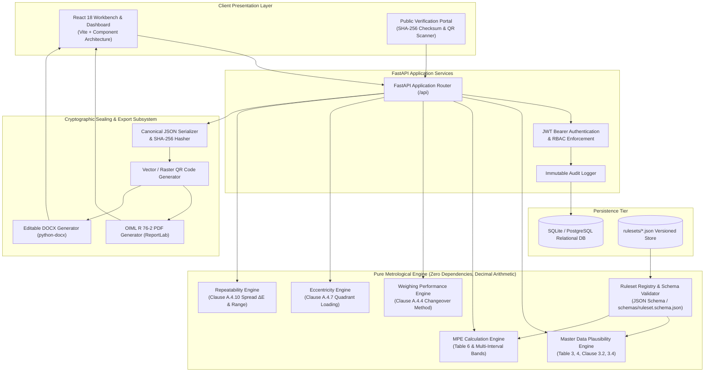
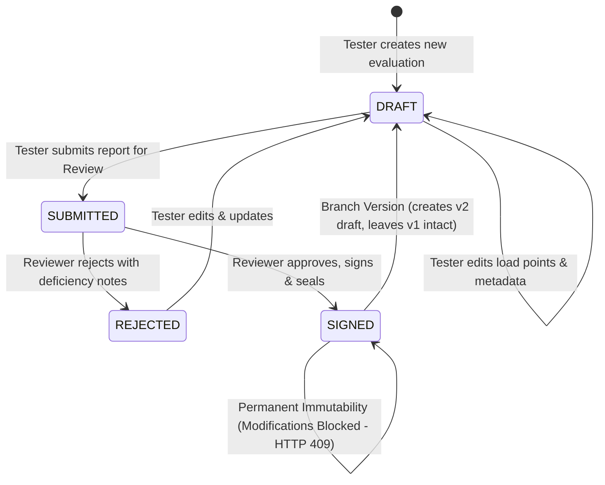
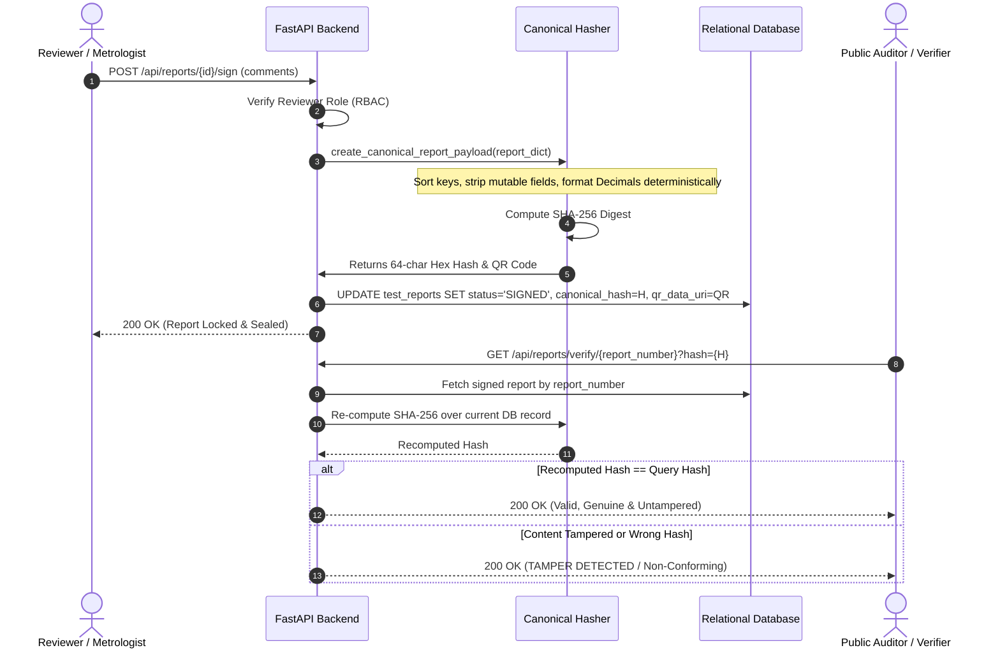

# WeighProof System Architecture
## NAWI Test Report Generator based on OIML R 76 (SIH 2026 - PS26035)

---

## 1. High-Level Architectural Topology

---

## 2. Core Metrological Engine Principles

1. **Deterministic Arbitrary-Precision Arithmetic**:
   The engine uses Python's `decimal.Decimal` exclusively. IEEE 754 floating-point numbers (`float`) are completely forbidden in calculations. This eliminates fractional representation drift (e.g. $0.1 + 0.2 \ne 0.3$), which would invalidate legal metrology compliance.
2. **Standard Rounding Rules**:
   Rounding operations are parameterized by the active ruleset (defaulting to `ROUND_HALF_UP` as specified in OIML R 76-1). Rounding is strictly confined to presentation layers; intermediate calculations maintain full precision.
3. **Changeover Point Error Determination**:
   Conforming to OIML R 76-1 Clause A.4.4.3:
   $$P = I + \frac{1}{2}e - \Delta L$$
   $$E = P - L = I + \frac{1}{2}e - \Delta L - L$$
   $$E_c = E - E_0$$
   where $E_0$ is zero error determined prior to loading.
4. **Explainable Verdicts (INNOVATION B)**:
   Every evaluation step returns a human-readable and machine-verifiable explanation citing the exact OIML clause, the numbers substituted into the formula, the applicable MPE limit, and the binary PASS/FAIL decision.

---

## 3. Report Lifecycle State Machine

---

## 4. Cryptographic Sealing & Tamper Evidence (INNOVATION C)

---

## 5. Security & RBAC Model

| Role | Instrument Creation | Test Evaluations | Save Draft | Submit Report | Sign & Seal Report | Reject Report | Manage Rulesets | View Audit Logs |
|---|---|---|---|---|---|---|---|---|
| **Tester** | ✅ Yes | ✅ Yes | ✅ Yes | ✅ Yes | ❌ Forbidden (403) | ❌ Forbidden (403) | ❌ Read Only | ❌ Forbidden (403) |
| **Reviewer** | ✅ Yes | ✅ Yes | ✅ Yes | ❌ (Review only) | ✅ Authorized | ✅ Authorized | ❌ Read Only | ✅ Authorized |
| **Admin** | ✅ Yes | ✅ Yes | ✅ Yes | ✅ Yes | ✅ Authorized | ✅ Authorized | ✅ Full Control | ✅ Full Control |

---

## 6. Multi-Format Export Architecture

1. **PDF (OIML R 76-2 Layout)**:
   - Generated dynamically via ReportLab.
   - Includes official Part 2 Test Report layout: Page 5 Instrument Characteristics, Page 9 Summary of Type Evaluation, Page 10 Weighing Performance Table, Page 12 Eccentricity, Page 16 Repeatability, Reviewer Signature Block, and embedded verification QR code image.
2. **DOCX (Editable Laboratory Report)**:
   - Generated dynamically via `python-docx`.
   - Formatted tables with bold headers, standard test rows, and high-resolution QR code image.
3. **JSON (DCC / Machine-Readable Format)**:
   - Aligned with EURAMET/CG-18 and PTB IMEKO TC6 (2025) Digital Calibration Certificate schemas.
