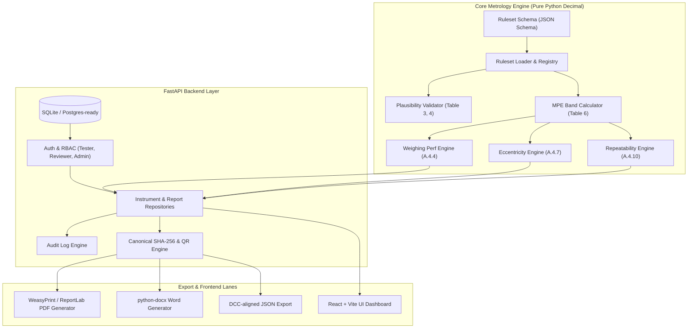

# WeighProof Project Plan (SIH 2026 - PS26035)
## NAWI Test Report Generator based on OIML R 76

---

## 1. System Vision & Problem Statement
* **Objective**: Automate and safeguard type evaluation (pattern approval) test reports for Non-Automatic Weighing Instruments (NAWI) strictly adhering to **OIML R 76-1:2006 / 1992** and **OIML R 76-2:2007**.
* **Core Philosophy**: Metrological correctness beats feature count. Every verdict is mathematically traceable to specific standard clauses. Precision is maintained via `decimal.Decimal` with explicit rounding.
* **Key Innovations**:
  1. **INNOVATION A — Versioned Rulesets**: Hot-swappable, schema-validated JSON/YAML rulesets. Adding a new standard edition requires zero code modifications.
  2. **INNOVATION B — Explainable Verdicts**: Fully transparent step-by-step mathematical proofs shown alongside every single PASS/FAIL verdict.
  3. **INNOVATION C — Tamper-Evident Artifacts**: Canonical SHA-256 payload hashing + embedded cryptographically verifiable QR codes; reports become permanently immutable upon Reviewer sign-off.

---

## 2. Dependency Graph & Architecture Overview

---

## 3. Strict Vertical Slices & Acceptance Criteria

### Slice 0: Foundation, Research & Test Oracles (S0)
* **Lanes**: Engine, QA/Docs.
* **Deliverables**:
  - `docs/KNOWLEDGE.md`, `docs/ASSUMPTIONS.md`, `docs/PLAN.md`.
  - Machine-readable hand-calculated test oracles: `docs/oracle/oracle_class_iii_6kg.json`, `docs/oracle/oracle_failing_cases.json`.
  - Ruleset schema: `schemas/ruleset.schema.json`.
  - Verified rulesets: `rulesets/oiml_r76_2006.json`, `rulesets/oiml_r76_1992.json`.
* **Acceptance Criteria**:
  1. JSON Schema validates both 2006 and 1992 rulesets cleanly.
  2. Test oracle covers complete 15-point weighing, 5-position eccentricity, and 10-run repeatability with exact manual numbers.

### Slice 1: Instrument Plausibility & Weighing Performance (S1)
* **Lanes**: Engine, Backend, Frontend.
* **Deliverables**:
  - Master data plausibility validator: verification scale interval $e \in \{1, 2, 5\}\times 10^k$, $n = Max/e \in [n_{min}, n_{max}]$ for Class I/II/III/IIII, $Min \ge 20e$ or $50e$, $d \le e$.
  - MPE determination engine for single and multi-interval instruments.
  - Weighing performance calculator: $P = I + 0.5e - \Delta L$, $E = P - L$, $E_c = E - E_0$, $|E_c| \le \text{mpe}$.
  - REST endpoints: `POST /api/evaluate/plausibility`, `POST /api/evaluate/weighing-performance`.
  - Frontend interactive weighing performance data entry and live verdict visualization.
* **Acceptance Criteria**:
  1. 100% agreement with `docs/oracle/oracle_class_iii_6kg.json` on weighing performance points.
  2. Plausibility checks reject illegal instruments with exact clause citations.

### Slice 2: Eccentricity & Repeatability Engines (S2)
* **Lanes**: Engine, Backend, Frontend.
* **Deliverables**:
  - Eccentricity engine: calculates required load $\approx 1/3 Max$, evaluates quadrants 1–4 and center, verifies $|E_c| \le \text{mpe}$.
  - Repeatability engine: evaluates 10 weighings ($Max < 1000\text{ kg}$) or $\ge 3$ weighings ($Max \ge 1000\text{ kg}$) at 50% and 100% Max, checks each $|E_i| \le \text{mpe}$ and range $E_{max} - E_{min} \le |\text{mpe}|$.
  - Modular test architecture allowing pluggable tests.
  - REST endpoints: `POST /api/evaluate/eccentricity`, `POST /api/evaluate/repeatability`.
* **Acceptance Criteria**:
  1. 100% agreement with `docs/oracle/` for eccentricity and repeatability.
  2. Deliberate failing corner or spread correctly flags FAIL with explainable reasons.

### Slice 3: Authentication, RBAC & Audit Trails (S3)
* **Lanes**: Backend, QA/Docs.
* **Deliverables**:
  - Roles: `Tester` (create, edit drafts, execute evaluations), `Reviewer` (review, approve/sign, lock), `Admin` (manage rulesets, user management, audit review).
  - JWT authentication with secure password hashing (`bcrypt`).
  - Immutable audit trail recording all creations, modifications, review sign-offs, and ruleset changes with timestamps and user IDs.
* **Acceptance Criteria**:
  1. Testers cannot approve or sign reports.
  2. Reviewer sign-off transitions report state to `SIGNED` and permanently locks modifications.
  3. Every mutation creates an audit record.

### Slice 4: Tamper-Evident Reports & Multi-Format Export (S4)
* **Lanes**: Reports, Backend, Frontend.
* **Deliverables**:
  - Canonical JSON serialization and SHA-256 cryptographic hashing.
  - QR Code generator linking to verification URL containing the hash and report ID.
  - PDF Generation adhering to OIML R 76-2 layout (Reportlab / HTML template).
  - Editable DOCX Generation (python-docx) adhering to standard test report tables.
  - Public verification endpoint: `GET /api/reports/verify/{report_id}?hash={sha256}`.
* **Acceptance Criteria**:
  1. Tampering with any field in a signed report immediately fails hash verification.
  2. PDF and DOCX exports contain all master data, test tables, explainable verdicts, SHA-256 checksum, and QR code.

### Slice 5: Repository, Search & Dashboard (S5)
* **Lanes**: Backend, Frontend.
* **Deliverables**:
  - Full report management dashboard: filter by status (`DRAFT`, `SUBMITTED`, `SIGNED`, `REJECTED`), class, manufacturer, date.
  - Dynamic ruleset selector and real-time live preview.
  - Synthetic test data loader: instant pre-fill of 6kg Class III, Class II lab balance, 30t weighbridge, and deliberate failing cases.
* **Acceptance Criteria**:
  1. Users can search and filter reports across multiple parameters.
  2. One-click loading of all synthetic test cases.

### Slice 6: Hardening, Comprehensive Testing & Evaluator Demo (S6)
* **Lanes**: QA/Docs, Full Team.
* **Deliverables**:
  - Pytest suite with $\ge 90\%$ test coverage on metrology engine.
  - End-to-end integration tests for full report lifecycle.
  - Complete documentation suite: `README.md`, `ARCHITECTURE.md`, `RULESET_GUIDE.md`, `TESTING.md`, `BUGS.md`, `DECISIONS.md`, `CHANGELOG.md`.
  - Self-contained runner script / Dockerfile.
  - 5-Minute Evaluator Demo Script.
* **Acceptance Criteria**:
  1. 0 failing tests across test suite.
  2. 0 open items in `BUGS.md`.
  3. 2 consecutive clean test runs.
  4. Fully passing Independent SIH Evaluator Third-Person Audit.
