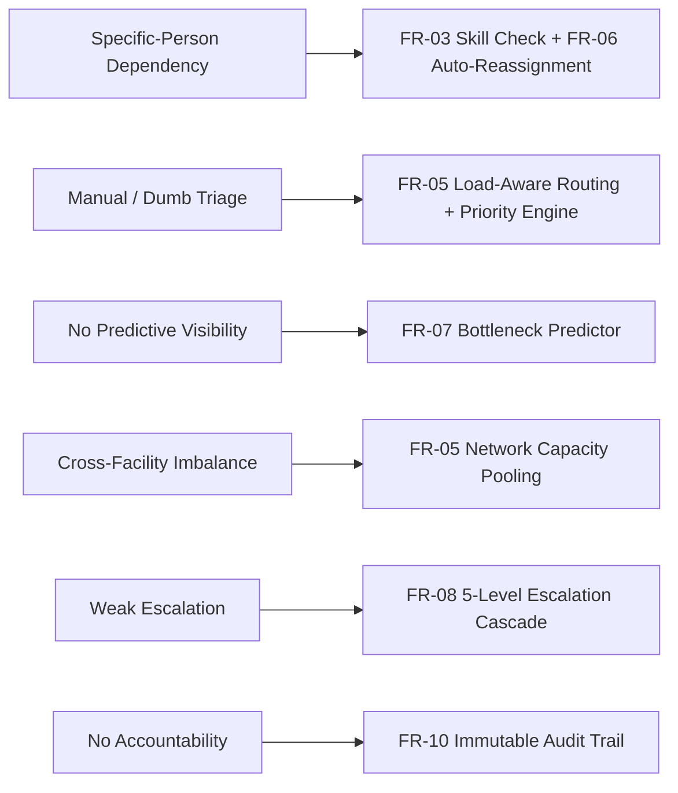

# 02 — Lite Software Requirements Specification (SRS)

**Source Basis**: `01_Lite_SRS.docx`

---

## 1. Product Definition

* **Product Name**: RadFlow Orchestrator (RFO)
* **Core Purpose**: Reduce radiology workflow blockage caused by dependency on specific or overloaded personnel by prioritizing, routing, monitoring, predicting, and escalating work items in real time.
* **Product Promise**: Keep the radiology pipeline moving even when a human link becomes unavailable or overwhelmed, while guaranteeing zero silent case drops.

---

## 2. Functional Requirements (FR-01 to FR-12)

| Req ID | Module / Area | Requirement Description | Acceptance Evidence |
| :--- | :--- | :--- | :--- |
| **FR-01** | Order Intake | The system shall accept new radiology orders containing exam ID, facility ID, modality, exam type, priority metadata, order timestamp, and SLA deadline via a REST API feed. | API returns HTTP 201/200; order is persisted and visible on the active worklist. |
| **FR-02** | Worklist View | The system shall display all active studies with real-time status, calculated priority, wait time, SLA countdown, assigned radiologist, and facility. | UI supports multi-criteria sorting/filtering; state updates without full page refresh. |
| **FR-03** | Qualification Check | The system shall verify radiologist specialty and sub-specialty eligibility before assigning a study. | System rejects automated assignment of specialty studies (e.g. Neuro CT) to unqualified staff. |
| **FR-04** | Availability Check | The system shall exclude unavailable, paused, or off-shift personnel from automated routing algorithms. | Unavailable staff are excluded from candidate scoring and annotated with reason in UI. |
| **FR-05** | Load-Aware Routing | The system shall rank eligible candidates using a configurable algorithm combining workload ratio, availability, urgency, and specialty. | Routing response exposes human-readable decision reason codes. |
| **FR-06** | Auto-Reassignment | The system shall automatically trigger reassignment when an assigned reader becomes unavailable or crosses an overload threshold. | Case transitions from previous resource to next eligible resource with audit log entry. |
| **FR-07** | Bottleneck Prediction | The system shall forecast potential SLA breaches using current queue depth, average service time, arrival rates, and remaining shift capacity. | Early-warning alert banner appears prior to SLA breach with estimated breach timestamp. |
| **FR-08** | Escalation Cascade | If a critical case remains unaccepted or unassigned after a configured SLA timer, the system shall escalate through a pre-defined 5-level hierarchy. | Each escalation level generates timestamped audit events and visible dashboard alerts. |
| **FR-09** | Admin Analytics | The system shall display real-time operational KPIs including average TAT, SLA breach counts, workload variance, and bottleneck frequency. | Analytics view updates dynamically from the operational data store. |
| **FR-10** | Immutable Audit Trail | The system shall log every state transition, automated assignment, reassignment, override, and escalation with actor ID, timestamp, and reason code. | Audit log view allows chronological reconstruction of every case lifecycle. |
| **FR-11** | Manual Override | Authorized operators shall be able to manually reassign orders or alter priorities, requiring a mandatory human reason entry. | Manual override supersedes automated rules and creates an immutable audit record. |
| **FR-12** | Simulation Mode | The system shall provide simulation controls to inject traffic bursts, staff unavailability, and capacity shocks for demo stress-testing. | Operator can trigger scenario presets (`S01`–`S08`) with reproducible random seeds. |

---

## 3. Non-Functional Requirements (NFR-01 to NFR-08)

| NFR ID | Quality Attribute | Requirement Description | MVP Target Metric |
| :--- | :--- | :--- | :--- |
| **NFR-01** | Trust & Explainability | Every automated decision must explicitly present the factors and policy version that caused it. | Reason codes and top 3 scoring factors displayed in UI. |
| **NFR-02** | System Responsiveness | Operational state changes must propagate quickly to user interfaces. | Near real-time UI update (< 1 second) via WebSockets / SSE. |
| **NFR-03** | Operational Safety | The system must guarantee zero silent case drops under all failure conditions. | 100% of unassigned/overdue cases reach visible Level-4 escalation. |
| **NFR-04** | Policy Configurability | Priority weights, overload ratios, SLA timers, and escalation delays must be configurable. | Admin policy JSON API allows runtime adjustments without redeployment. |
| **NFR-05** | Auditability | State machine transitions must be 100% reconstructable for compliance review. | Append-only event store with stable event UUIDs. |
| **NFR-06** | Data Privacy | The prototype must operate strictly on synthetic patient metadata. | Zero real Patient Health Information (PHI); synthetic IDs only (`PAT-XXXX`). |
| **NFR-07** | Interoperability Boundary | System must expose clean adapter interfaces for future RIS/FHIR/HL7 feeds. | Documented JSON REST schemas matching FHIR diagnostic order concepts. |
| **NFR-08** | Service Resilience | The core routing and decision engine must operate independently of dashboard UI availability. | Backend API state remains authoritative during UI disconnections. |

---

## 4. Traceability to Problem Statement

---

## 5. Scope Red Lines

> [!WARNING]
> **Strict Scope Limit**: Do NOT add image-reading models or DICOM viewers to the prototype. The winning hackathon strategy relies on presenting a complete, robust workflow orchestration plane—not a shallow diagnostic AI mockup.
