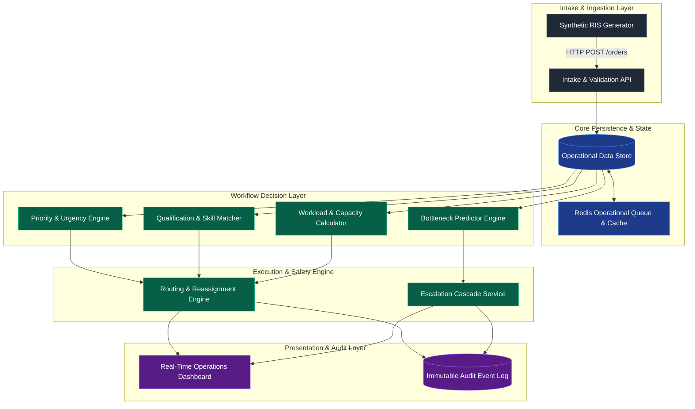
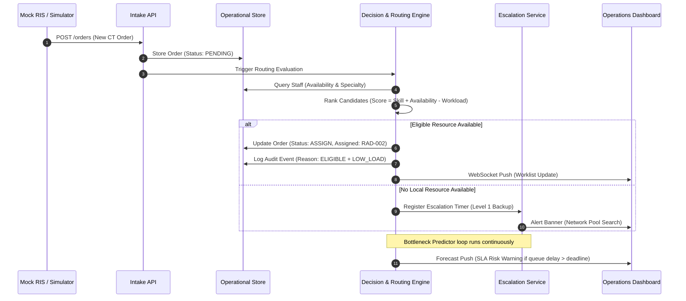

# 03 — System Architecture & Design Specification

**Source Basis**: `02_System_Architecture.docx`

---

## 1. Architectural Goal

RadFlow Orchestrator (RFO) is designed as a lightweight, high-performance **orchestration middleware** that interfaces conceptually between hospital information systems (RIS/HIS) and radiology workforce rosters. For prototype deployment, intake is simulated via a scenario generator while the routing engine, bottleneck predictor, and escalation state machine operate in real time.

---

## 2. Logical Architecture Diagram

---

## 3. Component Responsibilities Matrix

| Component | Primary Responsibility | Implemented in MVP? |
| :--- | :--- | :--- |
| **Mock RIS Feed** | Generates synthetic diagnostic orders, urgency flags, and arrival patterns. | **Yes** (Python scenario generator) |
| **Intake API** | Validates JSON schema, verifies data integrity, and persists order intake. | **Yes** (FastAPI endpoint `/orders`) |
| **Operational Store** | Maintains canonical state of orders, workforce roster, and policies. | **Yes** (PostgreSQL / Relational tables) |
| **Priority Engine** | Computes explainable priority score ($0–100+$) using structured order metadata. | **Yes** (Python rule-based scoring module) |
| **Qualification Engine** | Filters workforce candidates by modality and specialty requirements. | **Yes** (Set-intersection matching engine) |
| **Workload Engine** | Tracks active case counts and calculates real-time workload ratios ($\frac{\text{active}}{\text{max}}$). | **Yes** (In-memory Redis counter service) |
| **Routing Engine** | Scores eligible candidates and assigns/reassigns top-ranked radiologist. | **Yes** (Multi-factor ranking engine) |
| **Bottleneck Predictor** | Calculates estimated completion time and forecasts SLA breach risks. | **Yes** (Queue service time forecasting module) |
| **Escalation Service** | Manages timer-based multi-tier escalation cascade when cases stall. | **Yes** (Background scheduler / timer loop) |
| **Dashboard UI** | Displays real-time worklist, staff load, alert feeds, and simulator controls. | **Yes** (React + TypeScript + WebSockets) |
| **RIS/PACS Adapters** | Interfaces for DICOM C-STORE / FHIR DiagnosticReport integration. | **Interface Stub Only** (Documented boundary) |
| **Diagnostic AI** | Image interpretation, pixel analysis, or automated clinical reporting. | **No** (Deliberately out of scope) |

---

## 4. End-to-End Data Flow

---

## 5. Failure Handling & Resilience Rules

| Failure Scenario | System Handling & Mitigation Strategy |
| :--- | :--- |
| **No Eligible Local Resource** | Automatically expand candidate search pool to network/teleradiology resources across facilities. |
| **Zero Network Capacity Available** | Trigger Level-3 duty officer alert and transition case to visible `ESCALATED` status; never silently drop. |
| **Dashboard UI Disconnection** | Backend API state machine remains authoritative; websocket reconnects and resynchronizes state upon restore. |
| **Routing Engine Runtime Exception** | Catch exception, keep order in current state, raise critical system log alert, and fall back to manual queue view. |
| **Policy Definition Conflict** | Hardcoded safety policy (e.g., STAT urgency priority) takes precedence; conflict logged to audit log. |

---

## 6. Architecture Decisions for Judge Defense

1. **Middleware Architecture over RIS Replacement**: Preserves existing hospital software investments by acting as an intelligent orchestration layer rather than attempting to replace PACS/RIS.
2. **Metadata Processing over Image AI**: Keeps focus strictly on solving workforce bottlenecks and operational delays, avoiding unproven diagnostic AI claims.
3. **Configurable Rule Engine over Black-Box ML**: Ensures every decision is 100% explainable, transparent, and customizable to facility-specific operational policies.
4. **Append-Only Event Store**: Guarantees full auditability and enables replayability of simulation stress tests during judge Q&A.
