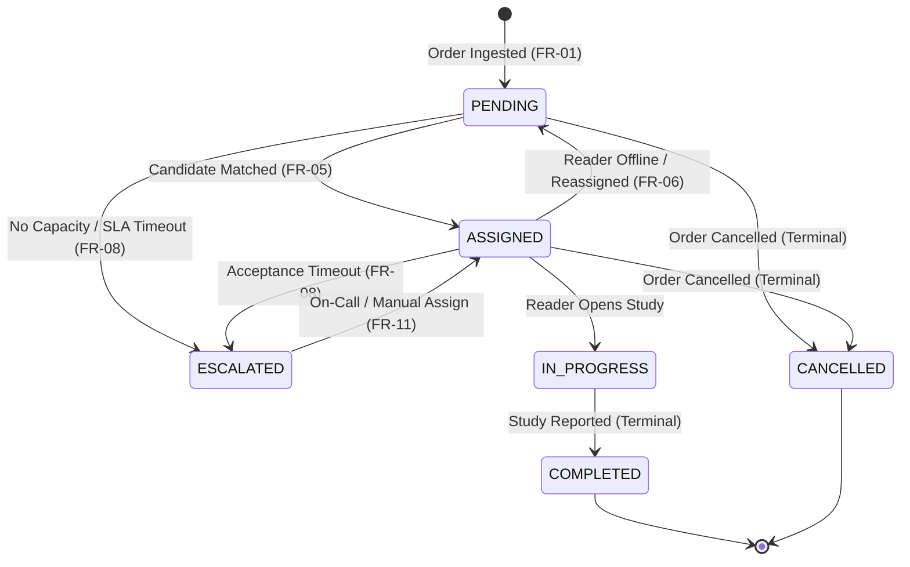

# 04 — Data Model & Schema Specification

**Source Basis**: `03_Data_Model_Schema.docx`

---

## 1. Design Principle

All backend micro-services, frontend views, synthetic traffic generators, and analytics modules consume a unified, canonical data contract. Synthetic patient identifiers (`PAT-XXXX`) are strictly enforced.

---

## 2. Canonical Order Schema

### JSON Schema Specification

```json
{
  "$schema": "http://json-schema.org/draft-07/schema#",
  "type": "object",
  "title": "RadiologyOrder",
  "required": [
    "exam_id",
    "facility_id",
    "synthetic_patient_id",
    "modality",
    "exam_type",
    "urgency_flag",
    "clinician_priority",
    "order_time",
    "sla_minutes",
    "sla_deadline",
    "status",
    "eligible_specialties",
    "patient_location",
    "created_by",
    "routing_policy_version"
  ],
  "properties": {
    "exam_id": { "type": "string", "example": "RAD-000123" },
    "facility_id": { "type": "string", "example": "FAC-CHN-01" },
    "synthetic_patient_id": { "type": "string", "example": "PAT-00421" },
    "modality": { "type": "string", "enum": ["CT", "MRI", "XR", "US"] },
    "exam_type": { "type": "string", "example": "HEAD_CT" },
    "urgency_flag": { "type": "string", "enum": ["STAT", "URGENT", "ROUTINE"] },
    "clinician_priority": { "type": "string", "enum": ["HIGH", "MEDIUM", "LOW"] },
    "order_time": { "type": "string", "format": "date-time", "example": "2026-09-07T09:15:00+05:30" },
    "sla_minutes": { "type": "integer", "minimum": 5, "example": 30 },
    "sla_deadline": { "type": "string", "format": "date-time", "example": "2026-09-07T09:45:00+05:30" },
    "status": { "type": "string", "enum": ["PENDING", "ASSIGNED", "IN_PROGRESS", "COMPLETED", "ESCALATED", "CANCELLED"] },
    "assigned_radiologist_id": { "type": ["string", "null"], "example": "RAD-002" },
    "eligible_specialties": { 
      "type": "array", 
      "items": { "type": "string" }, 
      "example": ["NEURORADIOLOGY", "EMERGENCY"] 
    },
    "patient_location": { "type": "string", "enum": ["ED", "INPATIENT", "OUTPATIENT", "ICU"] },
    "created_by": { "type": "string", "example": "MOCK_RIS" },
    "routing_policy_version": { "type": "string", "example": "v1.0" },
    "metadata": { "type": "object" }
  }
}
```

### Field Dictionary

| Field | Data Type | Required? | Validation Rule / Meaning |
| :--- | :--- | :--- | :--- |
| `exam_id` | String | **Yes** | Unique identifier for the diagnostic order. Primary Key. |
| `facility_id` | String | **Yes** | Facility code originating the study (e.g. `FAC-CHN-01`). |
| `synthetic_patient_id` | String | **Yes** | Mock patient identifier (`PAT-XXXX`). Zero PHI permitted. |
| `modality` | Enum | **Yes** | Modality code: `CT`, `MRI`, `XR`, or `US`. |
| `exam_type` | String | **Yes** | Operational exam classification (e.g. `CHEST_XR`, `HEAD_CT`). |
| `urgency_flag` | Enum | **Yes** | Operational priority: `STAT`, `URGENT`, or `ROUTINE`. |
| `clinician_priority` | Enum | **Yes** | Ordering physician priority indicator (`HIGH`, `MEDIUM`, `LOW`). |
| `order_time` | DateTime (ISO-8601) | **Yes** | Timestamp when order entered the intake pipeline. |
| `sla_minutes` | Integer | **Yes** | Maximum allowable turnaround duration in minutes. |
| `sla_deadline` | DateTime (ISO-8601) | **Yes** | Derived target completion timestamp (`order_time + sla_minutes`). |
| `status` | Enum | **Yes** | Active workflow state: `PENDING`, `ASSIGNED`, `IN_PROGRESS`, `COMPLETED`, `ESCALATED`, or `CANCELLED`. |
| `assigned_radiologist_id` | String / Null | No | Resource ID owning case. Must be `null` when `PENDING`. |
| `eligible_specialties` | Array[String] | **Yes** | Required radiologist skill tags (e.g. `['NEURORADIOLOGY']`). |
| `patient_location` | String | **Yes** | Operational source unit: `ED`, `INPATIENT`, `OUTPATIENT`, `ICU`. |
| `created_by` | String | **Yes** | Submitting subsystem identifier (e.g. `MOCK_RIS`). |
| `routing_policy_version` | String | **Yes** | Active policy version string used for routing evaluation. |

---

## 3. Canonical Workforce Schema

### JSON Instance Example

```json
{
  "radiologist_id": "RAD-002",
  "display_name": "Dr. Sarah Lin",
  "facility_ids": ["FAC-CHN-01", "FAC-CHN-02"],
  "specialties": ["GENERAL", "NEURORADIOLOGY", "EMERGENCY"],
  "available": true,
  "status": "ACTIVE",
  "max_active_cases": 12,
  "current_active_cases": 7,
  "on_call": true,
  "shift_end": "2026-09-07T18:00:00+05:30"
}
```

### Field Dictionary

| Field | Data Type | Meaning / Purpose |
| :--- | :--- | :--- |
| `radiologist_id` | String | Unique identifier for radiologist resource. |
| `display_name` | String | Human-readable string for UI rendering. |
| `facility_ids` | Array[String] | Facilities where radiologist holds reading credentials. |
| `specialties` | Array[String] | Certified skill competencies for eligibility checking. |
| `available` | Boolean | Real-time availability flag (false excludes from auto-routing). |
| `status` | Enum | Work status: `ACTIVE`, `PAUSED`, `OFFLINE`, `ON_CALL`. |
| `max_active_cases` | Integer | Configured active queue ceiling before overload flag triggers. |
| `current_active_cases` | Integer | Count of currently assigned `ASSIGNED` + `IN_PROGRESS` cases. |
| `on_call` | Boolean | On-call status indicator for Level-3 escalation eligibility. |
| `shift_end` | DateTime | Scheduled shift conclusion for capacity forecasting. |

---

## 4. Canonical Audit Event Schema

### JSON Instance Example

```json
{
  "event_id": "EV-00091",
  "exam_id": "RAD-000123",
  "event_type": "AUTO_REASSIGNMENT",
  "actor_type": "SYSTEM",
  "actor_id": "ROUTER-01",
  "timestamp": "2026-09-07T09:32:14+05:30",
  "from_resource": "RAD-001",
  "to_resource": "RAD-002",
  "reason_code": "OVERLOAD_AND_SLA_RISK",
  "policy_version": "v1.0",
  "details": {
    "queue_size_before": 14,
    "estimated_breach_minutes": 8
  }
}
```

---

## 5. Status State Machine



---

## 6. Data Quality & Integrity Validation Rules

1. **Uniqueness**: `exam_id` and `event_id` must be globally unique UUIDs/Strings.
2. **Temporal Consistency**: `order_time` must be $\le$ current simulation time. `sla_deadline` must equal `order_time + sla_minutes` unless an explicit policy override is logged.
3. **Resource Assignment Integrity**: `assigned_radiologist_id` MUST be `null` when `status == PENDING`.
4. **Availability Constraint**: No radiologist may be assigned a study if `available == false` or `status != ACTIVE`.
5. **Audit Enforcement**: 100% of state transitions MUST trigger an immutable `AuditEvent` object before persisting DB changes.
