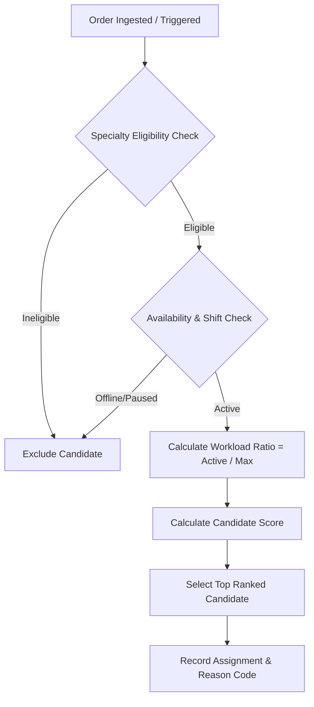

# 05 — Urgency, Routing & Escalation Rules Specification

**Source Basis**: `05_Urgency_Routing_Escalation_Rules.docx`

---

## 1. Core Principles

The decision engine is **operational, explainable, configurable, and human-overridable**. It operates exclusively on structured workflow metadata—never on image content. Priority weights and thresholds are policy-driven.

---

## 2. Priority Scoring Model

Dynamic operational priority score ($P$) is calculated per order using configurable metadata weights:

$$P = W_{\text{base}} + W_{\text{urgency}} + W_{\text{location}} + W_{\text{sla\_risk}} + W_{\text{override}}$$

### Recommended Baseline Weights

| Priority Component | Condition / Metadata | Point Weight | Rationale |
| :--- | :--- | :--- | :--- |
| **Urgency Flag: STAT** | `urgency_flag == "STAT"` | **+50** | Immediate life-safety priority boost. |
| **Urgency Flag: URGENT** | `urgency_flag == "URGENT"` | **+30** | Elevated operational priority. |
| **Urgency Flag: ROUTINE**| `urgency_flag == "ROUTINE"` | **+0** | Baseline routine queueing. |
| **Location: ED / ICU** | `patient_location IN ['ED', 'ICU']` | **+15** | Emergency department operational context. |
| **SLA Risk: Moderate** | Remaining SLA $\le 20$ minutes | **+25** | Prevents impending SLA breach. |
| **SLA Risk: Critical** | Remaining SLA $\le 10$ minutes | **+40** | High-urgency deadline escalation boost. |
| **Manual Override** | Human priority boost | Configurable | Explicit administrative override. |

> [!NOTE]
> Weights above represent a demonstration policy (`v1.0`). All weights are admin-configurable via `/api/v1/policies`.

---

## 3. Candidate Ranking & Assignment Algorithm

For every incoming or re-routed study:



### Ranking Mathematical Formula

Candidate Radiologist ($r$) score for order ($o$):

$$S(r, o) = S_{\text{specialty}}(r, o) + S_{\text{availability}}(r) + S_{\text{workload}}(r) + S_{\text{continuity}}(r, o) - P_{\text{risk}}(r)$$

Where:
* $S_{\text{specialty}}(r, o) = +40$ if sub-specialty exact match; $+20$ if general credentialed.
* $S_{\text{availability}}(r) = +30$ if `available == true` and `status == ACTIVE`.
* $S_{\text{workload}}(r) = 50 \times \left(1 - \frac{\text{current\_active\_cases}}{\text{max\_active\_cases}}\right)$.
* $S_{\text{continuity}}(r, o) = +10$ if $r$ previously reviewed prior studies for this patient.
* $P_{\text{risk}}(r) = 100$ if $r$ is flagged as overloaded ($\text{workload\_ratio} \ge 0.9$).

---

## 4. Bottleneck Prediction Logic

The bottleneck predictor calculates estimated queue completion time for each active radiologist:

$$T_{\text{forecast}}(r) = \sum_{i \in \text{Queue}(r)} \text{EST}(m_i) + \text{WaitTime}$$

Where $\text{EST}(m_i)$ is the historical average service time for modality $m_i$ (e.g. Head CT = 8 mins, Chest XR = 3 mins).

### Alert Triggers

System triggers an early-warning alert banner when ANY condition is met:
1. **Forecast SLA Miss**: $T_{\text{forecast}}(r) > \text{SLA\_Deadline}(o)$ for any assigned order $o$.
2. **Workload Overload**: $\text{workload\_ratio}(r) \ge 0.85$.
3. **Queue Wait Threshold**: STAT case unassigned duration $> 5$ minutes.

---

## 5. Cascading Safety Escalation Policy

```
[LEVEL 0]  Primary Assigned Radiologist
   │  (No acceptance within 5 mins OR reader goes unavailable)
   ▼
[LEVEL 1]  Qualified In-House Backup Radiologist (Same Facility)
   │  (No capacity OR acceptance timeout reached)
   ▼
[LEVEL 2]  Qualified Network Pool / Teleradiology Resource (Cross-Facility)
   │  (Zero network capacity)
   ▼
[LEVEL 3]  Shift-in-Charge / Duty Supervisor High-Priority Alert
   │  (Unresolved after 15 mins)
   ▼
[LEVEL 4]  Persistent Unresolved Critical Case Banner on Operations Dashboard
```

> [!IMPORTANT]
> **Safety Rule**: Every escalation level emits a timestamped `AuditEvent`. No state transition may silently delete or discard a case.

---

## 6. Manual Override Constraints

* Authorized operators can manually reassign orders or modify priority scores via UI.
* **Mandatory Field**: A text reason string (e.g., `PATIENT_DETERIORATION`, `PHYSICIAN_REQUEST`) is strictly required.
* Automations will NOT overwrite a manual human override unless a new explicit override is issued.

---

## 7. Safety & Judge Stress Cases

| Scenario | System Behavior |
| :--- | :--- |
| **All Facilities Overloaded** | Select only from credentialed available capacity; if zero capacity exists, escalate to Level-4 visible state. |
| **Only Unqualified Staff Available** | Refuse assignment to unqualified reader; raise Level-2 escalation immediately. |
| **Primary Reader Goes Offline Mid-Shift** | Trigger immediate auto-reassignment loop (FR-06) for all pending studies. |
| **Critical Case Enters Backlog** | Priority Engine calculates $+50$ boost, bumping case to head of queue ahead of routine studies. |
| **Decision Engine Failure** | System catches exception, preserves existing state, alerts admins, and prevents silent drops. |

---

## 8. Decision Explainability Output Template

When an automated routing action occurs, the engine generates an explainable summary payload:

```json
{
  "decision": "ASSIGN",
  "assigned_resource": "RAD-002",
  "reason_summary": "ELIGIBLE_SPECIALTY + AVAILABLE_NOW + LOWER_WORKLOAD + STAT_PRIORITY",
  "policy_version": "v1.0",
  "factor_scores": {
    "specialty_fit": "+40 (NEURORADIOLOGY)",
    "availability": "+30 (ACTIVE)",
    "workload_score": "+21 (Load ratio: 0.58)",
    "urgency_boost": "+50 (STAT)"
  },
  "alternatives_evaluated": [
    { "resource_id": "RAD-001", "rejection_reason": "OVERLOADED (Load ratio: 0.92)" },
    { "resource_id": "RAD-003", "rejection_reason": "INELIGIBLE_SPECIALTY" }
  ]
}
```
