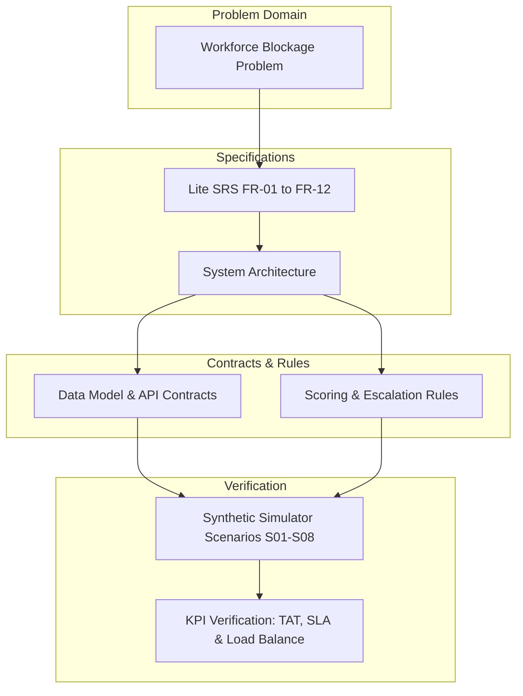

# 08 — Master Traceability Matrix

**Source Basis**: `00_Master_PreCode_Project_Plan.docx` & Engineering Specification Pack

---

## 1. Master System Traceability Matrix

The Master Traceability Matrix provides complete bi-directional mapping across all engineering disciplines—ensuring every problem statement need traces directly to software requirements, system architecture components, data schemas, API contracts, decision rules, simulation test scenarios, and sprint tasks.

| Operational Need | SRS Req ID | Architecture Component | Data Model Schema | API Endpoint Contract | Decision & Escalation Rule | Simulator Test Scenario | Sprint Execution Milestone |
| :--- | :--- | :--- | :--- | :--- | :--- | :--- | :--- |
| **Work Ingestion** | **FR-01** | Intake & Validation API | `RadiologyOrder` Schema | `POST /api/v1/orders` | Priority Metadata Input Rule | `S01` Normal Flow | **Hours 3–8h** (Eng 1 / Eng 4) |
| **Worklist Visibility** | **FR-02** | Operations Dashboard | `RadiologyOrder` Array | `GET /api/v1/orders` | Sorting & Filter Query Logic | All Scenarios (`S01`–`S08`) | **Hours 3–8h** (Eng 3) |
| **Qualification Matching**| **FR-03** | Qualification Engine | `eligible_specialties` | `POST /api/v1/orders` | Candidate Specialty Filter ($S_{\text{specialty}}$) | `S06` Zero Capacity | **Hours 8–14h** (Eng 1 / Eng 2) |
| **Availability Filter** | **FR-04** | Workload & Capacity Engine | `Workforce.available` | `PUT /api/v1/workforce/{id}/availability` | Availability Filter ($S_{\text{availability}}$) | `S04` Reader Offline | **Hours 8–14h** (Eng 1) |
| **Load-Aware Routing** | **FR-05** | Routing & Reassignment Engine | `Workforce` + `RadiologyOrder` | `PUT /api/v1/orders/{exam_id}/reassign` | Multi-Factor Ranking Algorithm $S(r,o)$ | `S01`, `S03`, `S05` | **Hours 8–14h** (Eng 1 / Eng 2) |
| **Auto-Reassignment** | **FR-06** | Routing & Reassignment Engine | `AuditEvent` + `RadiologyOrder` | `PUT /api/v1/orders/{exam_id}/reassign` | Overload & Unavailability Trigger | `S02` Single Overload, `S04` | **Hours 14–20h** (Eng 1 / Eng 2) |
| **Bottleneck Prediction** | **FR-07** | Bottleneck Predictor Engine | Queue EST + `sla_deadline` | `GET /api/v1/alerts` | Queue Completion Forecast Formula | `S02` Single Overload | **Hours 14–20h** (Eng 2 / Eng 4) |
| **Cascading Escalation** | **FR-08** | Escalation Cascade Service | `AuditEvent` + Alert Object | `GET /api/v1/alerts`, `POST /alerts/{id}/ack` | 5-Level Escalation Policy | `S06` Zero Capacity | **Hours 20–26h** (Eng 2) |
| **Admin Analytics & KPIs** | **FR-09** | Presentation & Analytics Layer | Aggregated Metrics JSON | `GET /api/v1/analytics/summary` | TAT, SLA & Load Variance Math | All Scenarios | **Hours 20–26h** (Eng 3 / Eng 4) |
| **Immutable Audit Trail** | **FR-10** | Event Store & Audit Log | `AuditEvent` Schema | `GET /api/v1/orders/{exam_id}` | Event Persistence Rule | All Scenarios | **Hours 14–20h** (Eng 2) |
| **Manual Human Override** | **FR-11** | Intake API / Routing Engine | `AuditEvent.actor_type` | `PUT /api/v1/orders/{exam_id}/reassign` | Human Override Precedence Rule | `S08` Manual Override | **Hours 14–20h** (Eng 1 / Eng 3) |
| **Simulation & Stress Mode**| **FR-12** | Synthetic Data Generator | Scenario Preset JSON | `POST /api/v1/simulation/events` | Deterministic Seed Generator | `S01` through `S08` | **Hours 3–26h** (Eng 4) |

---

## 2. Verification & Validation Traceability

