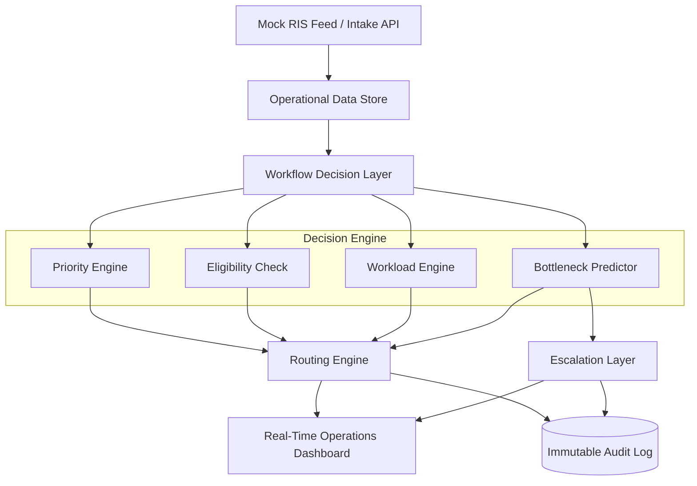

# 🏥 RadFlow Orchestrator (RFO) — Master Knowledge Base

Welcome to the canonical **RadFlow Orchestrator (RFO)** Knowledge Base. This repository contains the complete engineering specification, architecture design, API contracts, data schemas, decision rules, synthetic simulator plans, tech stack justification, sprint execution plan, and traceability matrix for building a workforce-aware radiology workflow orchestration layer.

---

## 📌 Executive Overview & Core Problem

Radiology departments face critical diagnostic pipeline blockages caused by **workforce dependencies**, **personnel overload**, and **inefficient manual triage**. When a specialized radiologist becomes unavailable or overwhelmed, case turn-around-times (TAT) spike, leading to severe SLA breaches.

**RadFlow Orchestrator (RFO)** acts as an intelligent, real-time operational control plane between incoming workflow intake (Mock RIS) and available workforce capacity.

> [!IMPORTANT]
> **Scope Guardrail (Non-Negotiable)**: RFO is an **operations and workflow orchestration middleware**, NOT a diagnostic AI. It does not interpret medical images (no fracture/hemorrhage detection, no automated diagnosis).

---

## 📁 Knowledge Base Structure

Navigating the engineering specifications:

| Module / Folder | Document | Purpose & Key Contents |
| :--- | :--- | :--- |
| **`01_executive_summary_and_vision/`** | [`problem_framing_and_vision.md`](file:///c:/Users/itzme/OneDrive/Documents/vit%20repo/knowledge_base/01_executive_summary_and_vision/problem_framing_and_vision.md) | Executive summary, evidence-backed problem framing, innovation differentiators, MVP scope red lines, KPI framework, and judge narrative. |
| **`02_functional_specifications/`** | [`lite_srs.md`](file:///c:/Users/itzme/OneDrive/Documents/vit%20repo/knowledge_base/02_functional_specifications/lite_srs.md) | Lite Software Requirements Specification: Functional Requirements (FR-01 to FR-12), Non-Functional Requirements (NFR-01 to NFR-08), and scope boundaries. |
| **`03_architecture_and_design/`** | [`system_architecture.md`](file:///c:/Users/itzme/OneDrive/Documents/vit%20repo/knowledge_base/03_architecture_and_design/system_architecture.md) | 3-tier logical architecture, ASCII & Mermaid flow diagrams, component responsibilities, failure mode handling, and system boundaries. |
| **`04_data_models_and_contracts/`** | [`data_model_and_schemas.md`](file:///c:/Users/itzme/OneDrive/Documents/vit%20repo/knowledge_base/04_data_models_and_contracts/data_model_and_schemas.md) | Canonical Order, Workforce, and Audit Event JSON schemas, status state machine (`PENDING` $\rightarrow$ `ASSIGNED` $\rightarrow$ `IN_PROGRESS` $\rightarrow$ `COMPLETED` / `ESCALATED`), and data quality rules. |
| | [`api_contracts.md`](file:///c:/Users/itzme/OneDrive/Documents/vit%20repo/knowledge_base/04_data_models_and_contracts/api_contracts.md) | REST API Catalogue, standard response envelopes, endpoint request/response payloads, and HTTP error code contract. |
| **`05_logic_and_rules/`** | [`urgency_routing_escalation_rules.md`](file:///c:/Users/itzme/OneDrive/Documents/vit%20repo/knowledge_base/05_logic_and_rules/urgency_routing_escalation_rules.md) | Priority scoring weights, candidate ranking algorithms, bottleneck forecasting triggers, 5-level escalation cascade, and human override logic. |
| **`06_simulation_and_data_generation/`** | [`synthetic_data_generator.md`](file:///c:/Users/itzme/OneDrive/Documents/vit%20repo/knowledge_base/06_simulation_and_data_generation/synthetic_data_generator.md) | Operational traffic distributions, 8 scenario stress tests (`S01`–`S08`), generator Python API, and seed determinism validation. |
| **`07_technology_and_execution/`** | [`tech_stack_decisions.md`](file:///c:/Users/itzme/OneDrive/Documents/vit%20repo/knowledge_base/07_technology_and_execution/tech_stack_decisions.md) | FastAPI + PostgreSQL + Redis + React/TS stack rationale, anti-patterns to avoid, and judge Q&A defense playbook. |
| | [`team_sprint_execution_plan.md`](file:///c:/Users/itzme/OneDrive/Documents/vit%20repo/knowledge_base/07_technology_and_execution/team_sprint_execution_plan.md) | 6-person team roles, 36-hour sprint milestones, Definition of Done, scope freeze rules, and pitch demo script. |
| **`08_traceability_matrix/`** | [`master_traceability_matrix.md`](file:///c:/Users/itzme/OneDrive/Documents/vit%20repo/knowledge_base/08_traceability_matrix/master_traceability_matrix.md) | Master traceability matrix mapping Problem Statement Needs $\rightarrow$ SRS Requirements $\rightarrow$ Architecture $\rightarrow$ Schemas $\rightarrow$ APIs $\rightarrow$ Rules $\rightarrow$ Simulator $\rightarrow$ Sprint Tasks. |

---

## 🚀 Quick Reference Architecture

---

## 🎯 Key Design Principles

1. **Workforce-Aware Routing**: Evaluates specialty, current active case count, max capacity ceiling, shift time remaining, and real-time availability.
2. **Predictive SLA Breach Detection**: Flags potential bottlenecks before deadlines are breached using arrival rate, service time, and queue depth.
3. **Explainable AI / Rules**: Every automated routing decision records human-readable reason codes (e.g., `ELIGIBLE + AVAILABLE + LOWER_WORKLOAD + STAT_PRIORITY`).
4. **Cascading Safety Escalation**: 5-level escalation policy ensures no critical case is ever silently dropped or stalled.
5. **Deterministic Simulation**: Built-in scenario generator allows live demonstration of stress cases (`S01` to `S08`) with reproducible random seeds.
